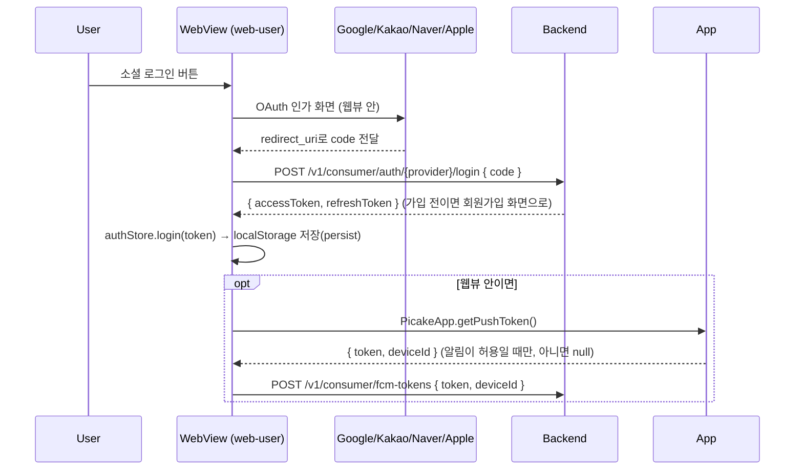
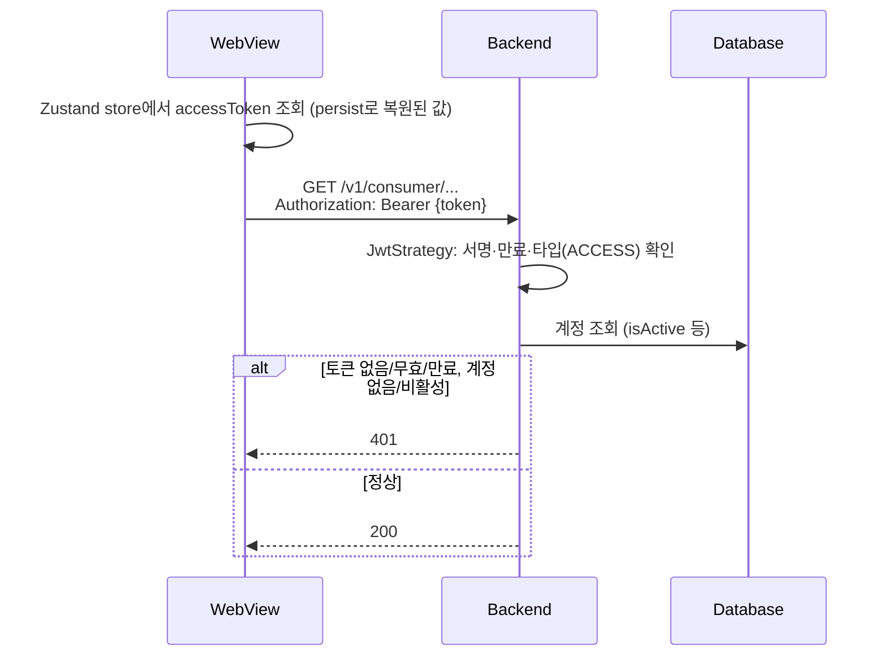
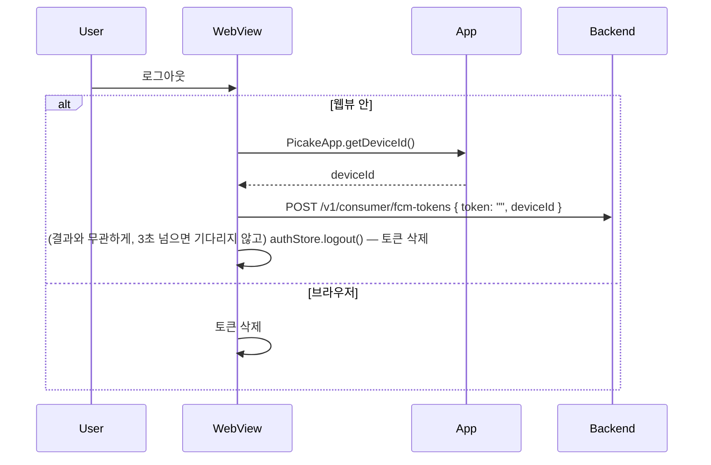

# 사용자 - 웹뷰 인증 가이드

## 📋 개요

손님 앱은 `web-user` 화면을 웹뷰로 감싼 앱입니다(앱 껍데기는 `picake-engineering-app`, 2026-11-13 Flutter → Capacitor). **로그인·회원가입은 웹(`web-user`)이 처리하고, 앱은 토큰을 따로 보관하지 않습니다.** 앱과 웹이 주고받는 것은 푸시(FCM) 토큰과 위치 같은 기기 기능뿐이며, 모든 앱 통신 코드는 `apps/web-user/src/common/utils/webview.bridge.ts`에 있습니다.

> 2026-11-05 정리: 예전 문서에는 "Flutter 앱이 아이디·비밀번호로 로그인하고 `window.Auth.login(token)`으로 웹에 넘긴다"는 흐름이 있었지만, 지금 코드에는 `window.Auth`·`window.Logout`이 없습니다. 손님 로그인은 Google·Kakao·Naver·Apple 소셜 로그인과 심사용 로그인뿐입니다(Naver는 2026-11-18~).

## 🎯 주요 특징

- **웹에서 로그인**: Google/Kakao/Naver/Apple OAuth를 `web-user`(`apps/web-user/src/app/auth/login/*`, `register/*`)가 code flow로 직접 처리합니다(웹뷰 안에서 진행, 브릿지 없음). provider 추가·수정 패턴은 `picake-auth-social-login` skill 참고.
- **헤더 기반 토큰 전송**: Authorization 헤더에 Bearer 토큰 포함
- **토큰 저장**: Zustand store + `persist`(웹뷰의 `localStorage`). 앱을 껐다 켜도 웹뷰 저장소가 유지되므로 로그인이 남습니다.
- **로그인·로그아웃 때 푸시 토큰 동기화**: 웹뷰 안이면 로그인한 상태에서 이 휴대폰을 알림 받을 곳으로 등록하고, 로그아웃할 때는 서버에서 이 휴대폰을 먼저 뺀 뒤 토큰을 지웁니다(아래 1·3·4).
- **웹뷰 판별**: `isWebViewEnvironment()` — 앱이 문서 맨 앞부터 넣는 `window.PicakeApp`이 있는지로 판단합니다. 우리 주소에만 있고, 카카오·구글 로그인 화면 같은 다른 사이트에는 없습니다.
- **약속 정본**: 메서드 이름·알림·링크 규칙의 정본은 앱 레포 `docs/bridge-contract.md` 1절입니다. 2026-11-21(첫 스토어 출시 전)에 Flutter 때 채널(`mylocation.postMessage("true")`, 앱이 `window.FcmToken.upsert`를 부르는 식)을 걷어내고 `window.PicakeApp` 하나로 바꿨습니다. 출시한 뒤에는 스토어에 남은 예전 앱도 받아야 하므로 메서드는 더하기만 합니다.
- **앱스토어 심사용 로그인**: `POST /v1/consumer/auth/review-login` — 마이페이지 버전 정보 화면의 `ReviewLoginBottomSheet`에서 진입 (`picake-review-ios-app-store` skill §2)

## 🔌 앱 약속 (`window.PicakeApp`)

메서드는 모두 Promise로 답하고, 실패는 `Error`에 `code`를 달아 reject합니다. 앱이 5초 안에 준비되지 않으면 `code: "unavailable"`로 끝납니다(웹이 기다리다 멈추지 않게). 손님 웹이 쓰는 것은 아래와 같습니다.

| 메서드                     | 웹에서 부르는 곳                        | 하는 일                                                                                                                                |
| -------------------------- | --------------------------------------- | -------------------------------------------------------------------------------------------------------------------------------------- |
| `getPushToken()`           | `registerPushDevice`                    | 알림이 허용일 때만 `{ token, deviceId }`, 아니면 `null`. 값이 있으면 `POST /v1/consumer/fcm-tokens`                                    |
| `on("pushToken", fn)`      | `useWebViewBridge`                      | 알림 토큰이 바뀌면 그 값으로 다시 등록                                                                                                 |
| `on("pushPermission", fn)` | `useWebViewBridge`                      | 앱이 앞으로 올 때마다 알림 허용 상태. 허용(`granted`)으로 바뀌면 `getPushToken()`으로 다시 등록                                        |
| `getDeviceId()`            | `unregisterPushDevice`                  | 로그아웃할 때 서버에서 이 휴대폰 토큰을 지우는 데 씀                                                                                   |
| `getLocation(onLastKnown)` | `requestLocationFromApp`                | 지금 위치. 마지막으로 알던 위치가 먼저 오면 그것부터 씀. 거부(`denied`)·위치 꺼짐·시간 넘김(`unavailable`)은 실패 처리                 |
| `openSettings("app")`      | `openAppSettings`                       | 휴대폰 설정의 이 앱 정보 열기(위치 권한 등)                                                                                            |
| `openExternal(url)`        | `openExternalInApp` ← `openExternalUrl` | 바깥 링크를 휴대폰 브라우저·그 앱으로 열기. 열 앱이 없으면 `unsupported`로 실패하고, 화면이 값 복사 + 안내로 대신함(`useOpenExternal`) |

- 손님 웹은 알림 허용을 묻지 않습니다. 손님 앱이 켤 때 한 번 묻습니다(`getPushPermission`·`requestPushPermission`은 판매자 웹만 씀).
- 위치는 처음 들어올 때 묻지 않고 지도·거리순 검색 결과·"현재 위치"처럼 필요할 때 묻습니다(`useLocationWhenNeeded`, `useUserLocation`). 전에 받은 적이 있으면 들어올 때 묻는 창 없이 한 번 다시 받습니다. 손님이 누른 요청이 실패하면 설정 안내 창이 뜹니다.

## 🔄 인증 흐름

### 1. 로그인 (웹에서 소셜 로그인)

이 휴대폰 등록은 로그인한 상태에서 ① 웹을 열 때 ② 로그인 직후 ③ 앱이 `pushToken`을 알려 줄 때 ④ `pushPermission`이 허용으로 바뀔 때 합니다(`useWebViewBridge`). 같은 값(로그인 토큰·알림 토큰·기기 ID)은 한 번만 보내고, 보내지 못했으면 다음 기회에 다시 보냅니다.

### 2. API 요청

### 3. 로그아웃

웹뷰 안에서는 **서버에서 이 휴대폰의 알림 연결을 먼저 지우고 로그아웃합니다**(`handleLogoutByEnvironment` → `unregisterPushDevice`). 그 요청에 로그인 토큰이 필요해서 웹 토큰보다 먼저 합니다. 앱·서버가 **3초** 안에 끝내지 못하면 기다리지 않고 로그아웃합니다(그때는 그 휴대폰으로 알림이 계속 갈 수 있음).

### 4. 401 처리

`apps/web-user/src/common/config/axios.config.ts`의 응답 인터셉터가 `401` + `ACCESS_TOKEN_INVALID`이면 `authStore.logout()`만 불러 이 기기에서만 로그아웃합니다. 서버의 알림 연결 해제는 같은 토큰이라 어차피 401이어서 부르지 않습니다. 그다음 "로그인한 뒤 이용해 주세요" 안내 후 현재 경로를 저장하고 로그인 화면으로 보냅니다.

### 5. 새로고침·앱 재실행

Zustand `persist`가 `localStorage`에서 토큰을 복원합니다. 앱 쪽에 따로 저장된 토큰은 없습니다. 웹뷰 저장소가 지워지면(앱 데이터 삭제 등) 다시 로그인해야 합니다.

## 판매자 앱 (준비 중)

판매자 앱("픽케이크 사장님", 기획 I-48)도 `web-seller`를 같은 방식으로 감싸고 같은 `window.PicakeApp`을 씁니다(위치는 쓰지 않음). 등록·로그아웃 흐름도 위와 같고(`apps/web-seller/src/common/components/providers/SellerAppBridgeProvider.tsx`), 운영자 대신 입력 중(기획 I-41)에는 이 휴대폰을 등록·해제하지 않습니다.

판매자 웹은 여기에 더해 알림 허용 상태·허용 창(`getPushPermission`·`requestPushPermission`, 처음 사용 안내와 홈 "켜기"), 알림 설정 열기(`openSettings("notification")`), 공유 창(`share`), 사진 저장(`saveImage`, 결과 안내는 웹이 띄움), 앱 버전(`version`)을 씁니다. `share`·`saveImage`는 메서드가 있는지 보고 쓰고, 없으면 브라우저 공유 창·복사, 다운로드로 갑니다. 판매자 앱을 처음 만들 때 앱담당자에게 부탁한 내용은 [판매자 앱 - 앱담당자 요청서](./판매자%20앱%20-%20앱담당자%20요청서.md)에 기록으로 남아 있습니다.
