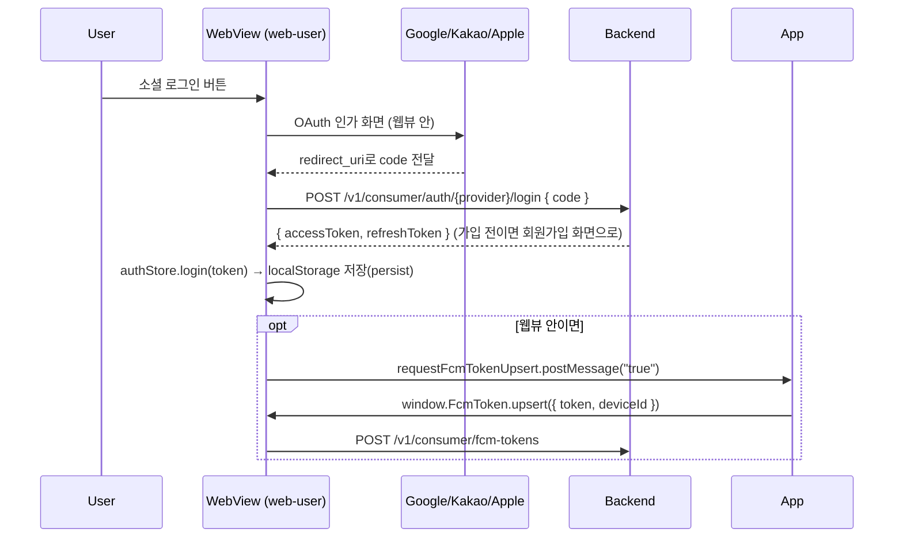
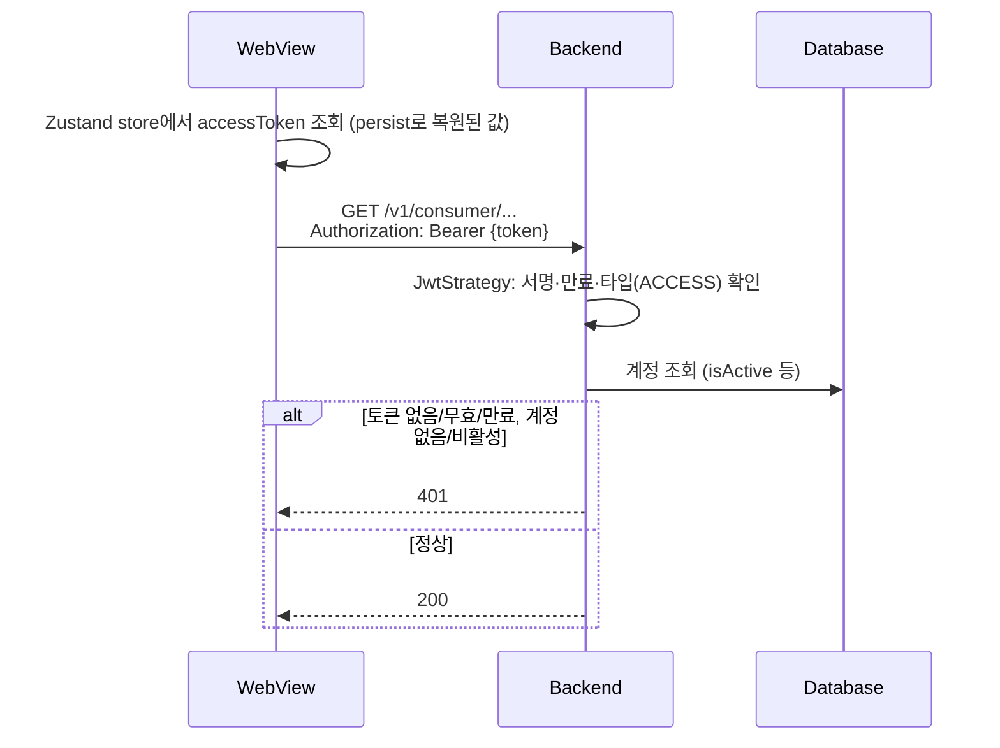
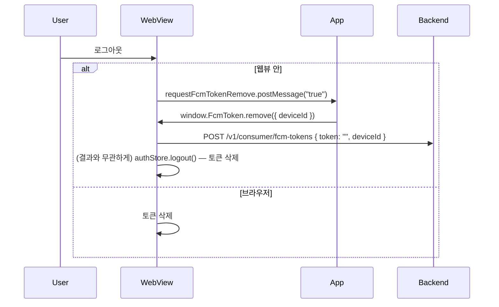

# 사용자 - 웹뷰 인증 가이드

## 📋 개요

손님 앱은 `web-user` 화면을 웹뷰로 감싼 앱입니다(앱 껍데기는 `picake-engineering-app`, 2026-11-13 Flutter → Capacitor). **로그인·회원가입은 웹(`web-user`)이 처리하고, 앱은 토큰을 따로 보관하지 않습니다.** 앱과 웹이 주고받는 것은 푸시(FCM) 토큰과 위치 같은 기기 기능뿐이며, 모든 브릿지 코드는 `apps/web-user/src/common/utils/webview.bridge.ts`에 있습니다.

> 2026-11-05 정리: 예전 문서에는 "Flutter 앱이 아이디·비밀번호로 로그인하고 `window.Auth.login(token)`으로 웹에 넘긴다"는 흐름이 있었지만, 지금 코드에는 `window.Auth`·`window.Logout`이 없습니다. 손님 로그인은 Google·Kakao·Apple 소셜 로그인과 심사용 로그인뿐입니다.

## 🎯 주요 특징

- **웹에서 로그인**: Google/Kakao/Apple OAuth를 `web-user`(`apps/web-user/src/app/auth/login/*`, `register/*`)가 code flow로 직접 처리합니다(웹뷰 안에서 진행, 브릿지 없음). provider 추가·수정 패턴은 `picake-auth-social-login` skill 참고.
- **헤더 기반 토큰 전송**: Authorization 헤더에 Bearer 토큰 포함
- **토큰 저장**: Zustand store + `persist`(웹뷰의 `localStorage`). 앱을 껐다 켜도 웹뷰 저장소가 유지되므로 로그인이 남습니다.
- **로그인·로그아웃 때 푸시 토큰 동기화**: 웹뷰 안이면 로그인 직후 앱에 푸시 토큰을 요청하고, 로그아웃할 때는 앱에 푸시 토큰 해제를 요청한 뒤 토큰을 지웁니다(아래 3·4).
- **웹뷰 판별**: `isWebViewEnvironment()` — 앱이 주입하는 `window.mylocation` 채널이 있는지로 판단합니다.
- **약속 정본**: 채널 이름·순서·알림·링크 규칙의 정본은 앱 레포 `docs/bridge-contract.md`입니다. 이름은 Flutter 앱 때와 같고, 바꾸면 스토어에 남은 예전 앱이 깨집니다.
- **앱스토어 심사용 로그인**: `POST /v1/consumer/auth/review-login` — 마이페이지 버전 정보 화면의 `ReviewLoginBottomSheet`에서 진입 (`picake-review-ios-app-store` skill §2)

## 🔌 브릿지 목록

| 방향    | 이름                                                                 | 하는 일                                                        |
| ------- | -------------------------------------------------------------------- | -------------------------------------------------------------- |
| 웹 → 앱 | `requestFcmTokenUpsert.postMessage("true")`                          | 로그인 직후, 앱에 푸시 토큰을 달라고 요청                      |
| 웹 → 앱 | `requestFcmTokenRemove.postMessage("true")`                          | 로그아웃할 때, 앱에 푸시 토큰 해제를 요청                      |
| 웹 → 앱 | `mylocation.postMessage("true")`                                     | 현재 위치 요청                                                 |
| 웹 → 앱 | `openAppSettings.postMessage("true")`                                | OS 앱 설정 화면 열기(위치 권한 등)                             |
| 앱 → 웹 | `window.FcmToken.upsert({ token, deviceId })`                        | 푸시 토큰 등록 → `POST /v1/consumer/fcm-tokens`                |
| 앱 → 웹 | `window.FcmToken.remove({ deviceId })`                               | 푸시 토큰 해제 → 같은 API에 빈 토큰, 끝나면 로그아웃           |
| 앱 → 웹 | `window.receiveLocation(lat, lng)` / `window.receiveLocationError()` | 위치 응답                                                      |
| 웹 → 앱 | `apps://` 로 시작하는 링크                                           | 앱이 가로채 외부 앱·브라우저로 열기 (`toExternalAppSchemeUrl`) |

## 🔄 인증 흐름

### 1. 로그인 (웹에서 소셜 로그인)

### 2. API 요청

### 3. 로그아웃

웹뷰 안에서는 **앱이 `window.FcmToken.remove`를 불러 줘야 로그아웃이 끝납니다.** 푸시 토큰 해제 API에 로그인 토큰이 필요해서, API를 부른 뒤(`onSettled`) 웹 토큰을 지웁니다.

### 4. 401 처리

`apps/web-user/src/common/config/axios.config.ts`의 응답 인터셉터가 `401` + `ACCESS_TOKEN_INVALID`이면 `handleLogoutByEnvironment()`를 부르고(위 3과 같은 로그아웃), "로그인한 뒤 이용해 주세요" 안내 후 현재 경로를 저장하고 로그인 화면으로 보냅니다.

### 5. 새로고침·앱 재실행

Zustand `persist`가 `localStorage`에서 토큰을 복원합니다. 앱 쪽에 따로 저장된 토큰은 없습니다. 웹뷰 저장소가 지워지면(앱 데이터 삭제 등) 다시 로그인해야 합니다.

## 판매자 앱 (준비 중)

판매자 앱("픽케이크 사장님", 기획 I-48)도 `web-seller`를 같은 방식으로 감싸고, 손님 앱과 같은 일을 하는 브릿지는 이름도 같습니다(위치 브릿지는 쓰지 않음). 판매자 앱에서 새로 쓰는 채널(알림 허용, 공유 창, 사진 저장, 앱 버전)과 휴대폰 알림·앱 껍데기가 할 일은 [판매자 앱 - 앱담당자 요청서](./판매자%20앱%20-%20앱담당자%20요청서.md)에 모아 두었습니다.
