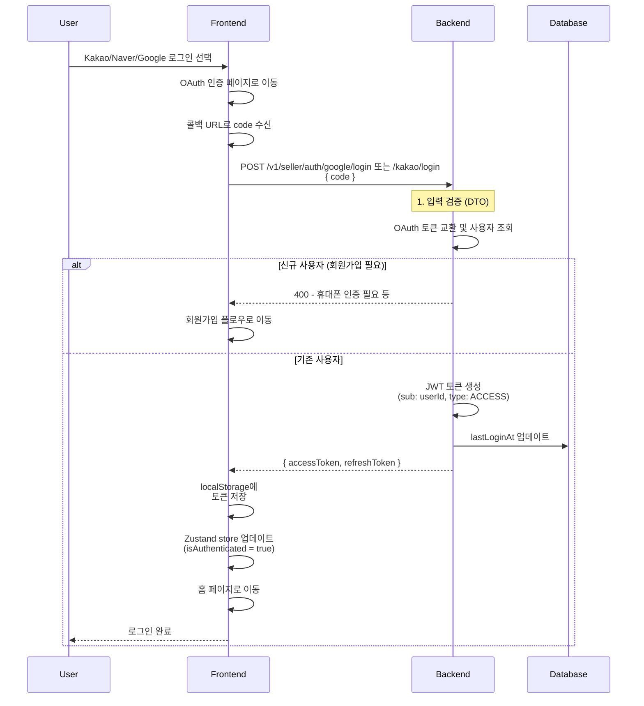
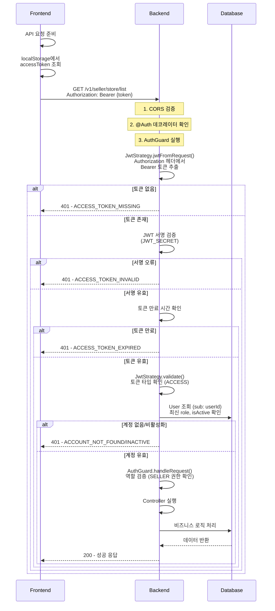
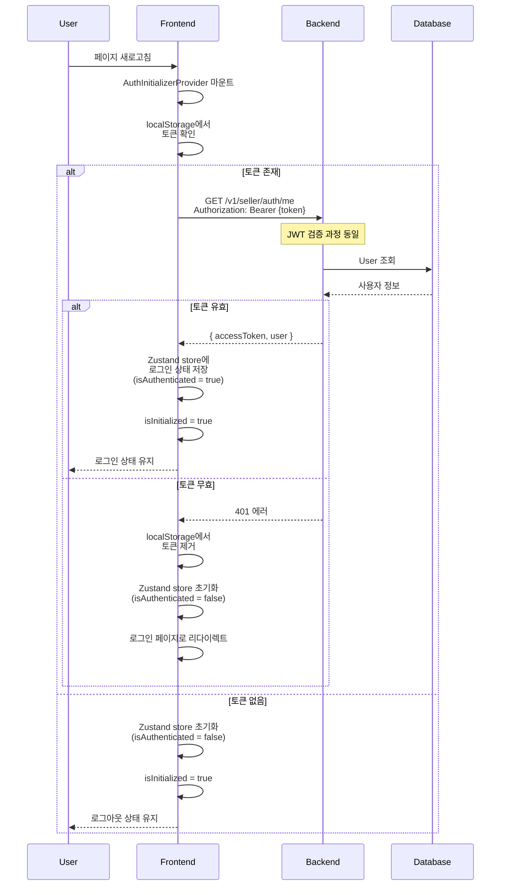
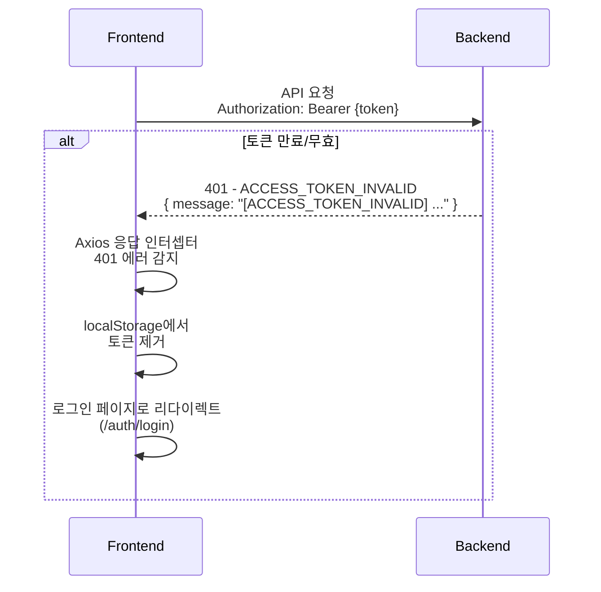
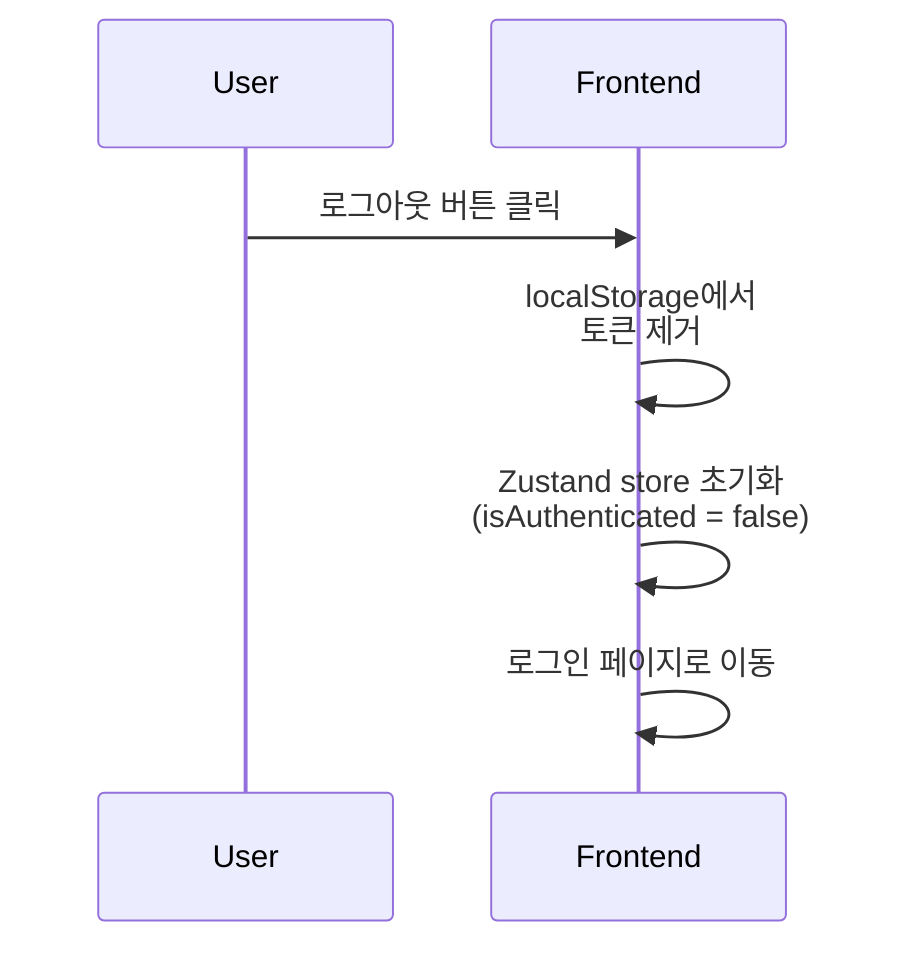

# 판매자 인증 가이드

## 📋 개요

Picake 플랫폼의 판매자 인증 시스템은 웹 애플리케이션 환경에서 동작하도록 설계되었습니다. localStorage를 사용한 토큰 관리와 자동 로그인 상태 복원 기능을 제공합니다.

## 🎯 주요 특징

- **localStorage 기반 토큰 저장**: 브라우저 localStorage에 토큰 저장
- **헤더 기반 토큰 전송**: Authorization 헤더에 Bearer 토큰 포함
- **자동 로그인 상태 복원**: 새로고침 시 `/me` API로 자동 복원
- **자동 리다이렉트**: 401 에러 시 로그인 페이지로 자동 이동
- **소셜 로그인 provider**: 카카오·네이버·구글(네이버는 웹에 Client ID를 넣은 환경에서만 버튼이 보임 — staging 11-16, 상용 2026-11-18 네이버 검수 승인 뒤). Apple 로그인은 web-user(소비자) 전용이며 web-seller에는 아직 없습니다. "이미 가입한 계정" 화면의 네이버 버튼은 `auth_type=reauthenticate`로 네이버 아이디·비밀번호를 다시 받습니다(네이버 아이디가 둘인 사람이 지금 로그인된 다른 아이디로 넘어가지 않게, 2026-11-18).
- **가입은 가입표(`registerToken`, 30분)로만**: 소셜 로그인했는데 계정이 없으면 서버가 가입표를 주고, 가입 화면이 가입표 + 번호로 가입합니다. 카카오·네이버는 그 서비스가 준 번호로 문자 인증 없이 가입할 수 있고("다른 번호"면 문자 인증), 구글은 구글 이름을 채워 둡니다(2026-11-16). 자세한 규칙은 `.claude/skills/picake-auth-social-login/SKILL.md`.

## 🔄 전체 인증 플로우

### 1. 로그인 플로우 (웹 앱 → 백엔드)

### 2. API 요청 플로우 (웹 앱 → 백엔드)

### 3. 새로고침 시 로그인 유지 플로우

### 4. 401 에러 처리 플로우

### 5. 로그아웃 플로우

